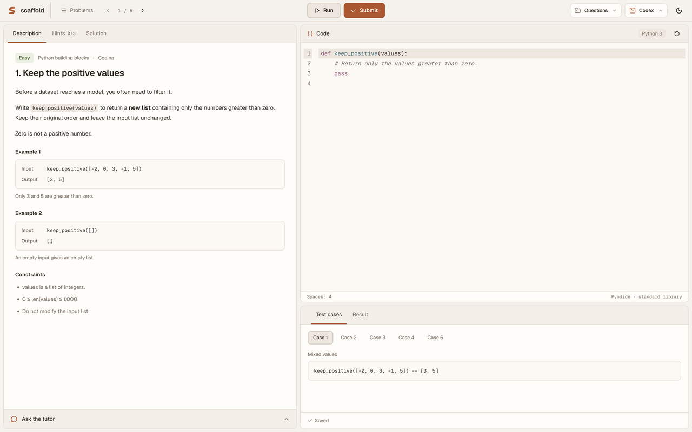

# Scaffold

[Download for Mac](https://github.com/viciousbuilders/scaffold/releases/latest) · [Product page](https://viciousbuilders.com/scaffold)



A personal Mac learning workspace for any topic: languages, history, science, writing, arts, technology and more. Set a learning goal, build a project, bring in exercises, and practise in a focused split view. Your curriculum, questions, notes and progress live in a local folder. You can also create or extend curricula by chatting with Codex in that folder; no question-generation service is required.

## Install the Mac app

Download the latest DMG, drag **Scaffold.app** into Applications, and open it. The first release supports **Apple silicon Macs with macOS 13 or later**. Install and sign in to your preferred AI CLI separately if you want the optional tutor. No AI provider login is required for local code tests, numeric questions or quizzes.

## Use the local app

Open `dist/Scaffold-darwin-arm64/Scaffold.app` after building it. The app starts its own private loopback process; no web hosting or API key is needed. Choose a locally installed AI CLI from the **AI settings** menu in the top bar for optional tutor chat and conceptual-answer grading. Codex is the default; Claude Code, OpenCode, Pi and custom commands are supported. Sign in through that CLI in Terminal first. Numeric answers, quizzes and code tests are checked locally.

The default workspace is `~/Documents/Scaffold`. The folder button in the top bar chooses another workspace; The learning hub starts with your projects and offers **Library**, **Review**, and optional **AI research** and **GPU programming** paths. Open the same folder in Codex and describe your goals. Scaffold creates `AGENTS.md`, `SCAFFOLD.md` and JSON schemas if they are missing, so Codex knows the format. Existing instructions are preserved.

- `curriculum.json`: your learning goal, level, formats and ordered modules.
- `questions.json`: `{ "questions": [...] }`, with stable question IDs.
- `progress.json`: Scaffold-owned answers, feedback, hints, tutor conversations and completion. Codex should leave this file alone.

Scaffold checks the files every three seconds while visible. Invalid edits show an error and keep the last valid questions on screen. Keep question IDs stable when editing to retain matching answers. Progress is saved separately and atomically. Existing browser work is migrated to the default workspace on first use.

### Research path, sources and review

The optional **AI research** path offers six ordered stages: mathematical reasoning, ML training loops, autograd/attention, training systems, post-training and a reproducible research investigation. **Add research path** installs 18 starting activities with explicit deliverables. These are diagnostic exercises and project milestones, not an exhaustive course, automatic adaptation or a promise of recruitment. Existing question IDs and progress are preserved; an existing curriculum keeps its title, goal and modules. Only its allowed formats expand if needed.

**GPU programming** adds a separate six-stage PyTorch and GPU programming path with 12 activities: tensor layouts/broadcasting, autograd/SGD, training/checkpointing, launch indexing/timing, CUDA/Triton vector addition, and accumulation/AMP. Two exercises run in the browser; ten external labs provide editable starter code, downloadable `.py`/`.cu` files, included checks, reference implementations and environment instructions. Seven labs can be checked on CPU PyTorch. CUDA C++, Triton and CUDA AMP labs require an NVIDIA environment. Scaffold does not provision cloud GPUs or run these external labs itself.

For an external lab, complete the code, **Download code**, run the file in your own environment, then record the command, device and output under **Run output & explanation**. **Record lab** stores a self-reviewed attempt; it does not claim the external checks were independently verified. Use the original research path to connect these skills to larger modelling experiments.

**Library** keeps your existing workspace questions and offers:

- A bundled Exercism binary-search import with instructions and canonical cases pinned to an upstream commit. Missing-value errors are adapted to Python `-1`; the local checker is not the Exercism platform judge. The original MIT notice is included in `public/licenses/exercism.txt`.
- LeetCode and Lichess links with local notes and self-reported completion. No scraping, account synchronization, hidden LeetCode tests or native chess engine is included.
- A checked poker EV exercise and optional hand-review, Chinese-recall and active-reading activities.

Questions can include optional `source` metadata (provider, HTTPS URL, external ID, version, license, attribution) and `assessment: "self-review"`. Self-reviewed activities record evidence without an AI correctness judgment. PyTorch, GPU and larger training investigations run in your own environment; record code links, configurations and results in Scaffold.

**Review** surfaces saved questions, unfinished work, mistakes and attempts that used hints, a solution or the tutor. **Start fresh** archives changed work before clearing the current answer; it retains up to 100 recorded attempts per question. Submission history distinguishes local tests, numeric/quiz answer keys, provisional AI feedback and self-reported activity. Existing drafts remain compatible. Review is activity-based, not a spaced-repetition scheduler or inferred mastery score.

### Format question text

Descriptions, example explanations, constraints, hints, solutions and tutor messages render Markdown, including headings, lists, tables, **bold text** and `inline code`. Use `$...$` for inline LaTeX and `$$...$$` on separate lines for display equations. Plain text stays plain text; add the formatting to your question files or ask your coding agent to do it.

In JSON strings, escape LaTeX backslashes and use `\n` for line breaks. For example:

```json
{
  "description": "Calculate **mean squared error** for `actual` and `predicted`.\n\n$$\n\\operatorname{MSE} = \\frac{1}{n} \\sum_{i=1}^{n} (\\hat{y}_i - y_i)^2\n$$",
  "explanation": "The mean squared difference is $\\frac{4}{3}$."
}
```

## AI providers

Open the provider name in the top bar, choose a CLI, and click **Save & check**. Leave **Model** empty to use that CLI's own default, or enter a model it supports (OpenCode uses `provider/model`). Each provider remembers its own model and executable. **Command settings** accepts an executable name on PATH or an absolute path; common Mac, Homebrew, pnpm and nvm locations are also searched when the app launches from Finder.

| Provider    | Setup in Terminal                           | Request mode                                                                     |
| ----------- | ------------------------------------------- | -------------------------------------------------------------------------------- |
| Codex       | `codex login`                               | `codex exec`, JSON schema, ephemeral session, read-only sandbox                  |
| Claude Code | `claude auth login`                         | Print mode, JSON schema, no saved session, built-in tools and MCP disabled       |
| OpenCode    | `opencode auth login`                       | `opencode run --format json`, dedicated tutor agent with denied tool permissions |
| Pi          | Open `pi`, use `/login`, and choose a model | Print mode, no session, tools, extensions, skills or context files               |
| Custom CLI  | Configure and authenticate your own command | Prompt on stdin, JSON response on stdout                                         |

Checks verify Codex/Claude authentication without making a model request. For OpenCode, Pi and custom commands they confirm the executable is present; authentication and model availability are checked on the first request. Scaffold never silently switches providers after an error.

The adapters follow the official [Codex non-interactive documentation](https://developers.openai.com/codex/noninteractive), [Claude CLI reference](https://code.claude.com/docs/en/cli-reference), [OpenCode CLI documentation](https://opencode.ai/docs/cli/) and [Pi source](https://github.com/earendil-works/pi/tree/main/packages/coding-agent). Use a current CLI release. Requests run in temporary directories, can be cancelled, have a five-minute limit and cap CLI output. OpenCode may keep its own session history; Scaffold does not resume it. The app uses each CLI's existing authentication/configuration and never packages `.env` files. It strips the old app's `OPENAI_API_KEY` and `OPENAI_MODEL` so they cannot override CLI authentication. Configure credentials through your CLI's native login/configuration; Scaffold has no API key field. Inference uses the selected provider's internet connection and account limits.

The tutor receives an allowlisted problem and current attempt, without solutions, answer keys or tests. The same selected provider grades conceptual answers. Numeric answers, quizzes and code tests remain local. Prompting encourages hints but cannot guarantee that a model will never infer an answer.

### Other AI CLIs

Choose **Custom CLI** and enter an executable plus a JSON array of arguments, for example `["--print", "--model", "{model}"]`. Arguments are passed directly without a shell. The command must read the complete prompt from stdin, exit when finished and write a JSON object matching the schema in the prompt to stdout. A single JSON Markdown fence is also accepted. `{model}`, `{schema}` and `{schemaPath}` placeholders are supported in arguments; the schema file exists for the duration of the request. For CLIs with different input/output protocols, point Scaffold at a small executable wrapper that adapts this contract. Configure non-interactive mode and tool restrictions in that command; Scaffold cannot infer flags for an arbitrary CLI. Do not put secrets in arguments.

AI preferences are stored separately in `~/Library/Application Support/Scaffold/ai.json`; changing providers does not touch question files or progress.

Python runs in an isolated Pyodide worker. Its first use downloads the pinned Python runtime. It supports standard-library exercises, not GPU training or arbitrary packages. Runs can be stopped and time out after ten seconds. AI-authored solutions and tests should be checked by Codex before saving them.

## Develop and build

```sh
npm install
# If your npm policy skipped Electron's binary download:
node node_modules/electron/install.js
npm run desktop:dev
```

Build the standalone Mac app:

```sh
npm run desktop:package
```

This creates a local unsigned app in `dist/` for the current Mac architecture. Set `SCAFFOLD_SIGNING_IDENTITY` to your Developer ID Application identity for a signed build. `npm run desktop` builds and launches the desktop shell without packaging. `npm run dev` retains a local browser preview for development.

The current workspace preference lives at `~/Library/Application Support/Scaffold/workspace.json`. Question content and progress live inside your chosen workspace. The settings menu can select a non-standard CLI installation. Optional environment overrides are `SCAFFOLD_CODEX_PATH`, `SCAFFOLD_CLAUDE_PATH`, `SCAFFOLD_OPENCODE_PATH` and `SCAFFOLD_PI_PATH`.

## Structure and checks

`desktop/` owns the window and folder picker. `src/server/workspace.ts` owns filesystem access. `src/core/` defines question and progress formats. `src/features/` contains the workspace view, practice editor and tutor. `src/server/ai/` owns provider adapters, local preferences and subprocess execution.

```sh
npm run typecheck
npm run lint
npm test
npm run build
```

Tests cover grading, question integrity, tutor context, CLI subprocess cancellation and workspace preservation. Tests use fake CLIs and never spend provider usage. The sample solution checks require Python 3.

### Coding languages

Coding questions use a `language` field: `python` (default for existing questions), `javascript`, `cpp`, or `cuda`. Scaffold chooses the editor and runner automatically; there is no language menu that changes the problem's tests.

| Language   | Execution                                                                              |
| ---------- | -------------------------------------------------------------------------------------- |
| Python 3   | Pyodide worker; first run downloads the runtime                                        |
| JavaScript | Fresh browser worker; async functions supported, no Node imports                       |
| C++17      | Local `clang++` or `g++`; install Xcode command line tools on Mac                      |
| CUDA C++   | Editing supported; execution requires `nvcc` and an NVIDIA GPU on a compatible machine |

Cloud GPU execution is a future addition. CUDA Run/Submit stay disabled on this Mac with an explanation. Optional compiler paths: `SCAFFOLD_CPP_COMPILER` and `SCAFFOLD_CUDA_COMPILER`.

Tests are boolean expressions in the question's language. C++ and CUDA answers contain functions and optional includes; Scaffold supplies `main()`. JavaScript tests may use `await`. Native snippets execute as local processes with your user permissions, a 20-second compilation limit, a 10-second execution limit, and capped output. JavaScript also has a 10-second execution limit. Read `LANGUAGES.md` in your question folder when authoring questions with Codex.

### In-app Colab GPU execution

External programming labs now include a Colab panel. **Connect GPU** requests an eligible free-tier standard T4, **Run on GPU** streams output into the lab, **Stop run** interrupts the lab by closing its kernel session, and **Release GPU** deletes Scaffold's runtime. Python files run in a fresh session; complete CUDA `.cu` files compile remotely with `nvcc`. Runtime creation may take several minutes. Existing runtimes belonging to other clients are not adopted or deleted.

This first connector supports an already-authorized Google Desktop OAuth grant with the `https://www.googleapis.com/auth/colaboratory` scope. Enable `colaboratory.googleapis.com` in that client's project, then import the private client and authorized token files:

```sh
node scripts/setup-colab.mjs /private/client.json /private/colab-token.json
```

Credentials stay in `~/Library/Application Support/Scaffold/colab/credentials.json` with owner-only file permissions, not in the renderer, workspace or app bundle. Access tokens refresh automatically; a revoked/expired refresh grant needs reauthorization. A full in-app Google sign-in flow is not included yet. The connector intentionally refuses paid subscription tiers.

GPU output is retained while the app server runs, capped at 100,000 characters. Save a successful run to activity history before closing. Saving output does not certify mastery or overwrite newer editor work. Normal close/quit waits for GPU cleanup before shutting down. Run connects automatically when needed; five minutes without GPU work releases the runtime. On the next launch, Scaffold cleans up its persisted runtime before starting. If release cannot be confirmed (for example, offline), normal shutdown keeps the app open and retains the ownership record for retry. Force-kill/power loss cannot guarantee immediate release; cleanup is retried on the next launch. **Release GPU** remains available for immediate manual release. Runtime files are temporary and disappear on release. Long-running job recovery, rich plot transport and checkpoint downloads are not included in this first version.

### Python editor

Python questions and labs include local Ruff diagnostics, a Problems panel and a Format action (`Cmd/Ctrl+Shift+F`). `Cmd/Ctrl+Shift+M` opens Problems. The editor also supports Tab indentation, code folding and bracket matching. Ruff ships as WebAssembly with the desktop server; linting/formatting neither executes Python nor requires a Python installation, GPU connection or external service. Diagnostics cover syntax and common errors such as undefined names and unused imports; this is not a Python type checker or project-wide language server. Formatting is explicit and never replaces code edited while the request was in flight.

### Projects and focused practice

Home now starts with your active project (the first with unfinished steps), or your current unfinished exercise. Create a project with a goal, subject and optional web source; add steps, link installed exercises, and keep notes/questions and experiment results in separate tabs. You can edit, archive and restore projects. Step completion is self-recorded. Linked practice retains its original test/AI/self-review evidence. Projects are saved in the workspace's `progress.json`, with a local browser backup; old workspaces need no migration. Sources open on their original websites.

Subject suggestions are starting points, not restrictions. Enter any subject when creating or editing a project. Library filters include the topics in your own exercises. Ask your AI CLI in the workspace folder to create a curriculum and written questions, quizzes or self-reviewed activities for your goal; coding is optional. The AI research and GPU programming paths remain optional specialist resources. Existing projects, questions and progress are preserved, including older subject names.
